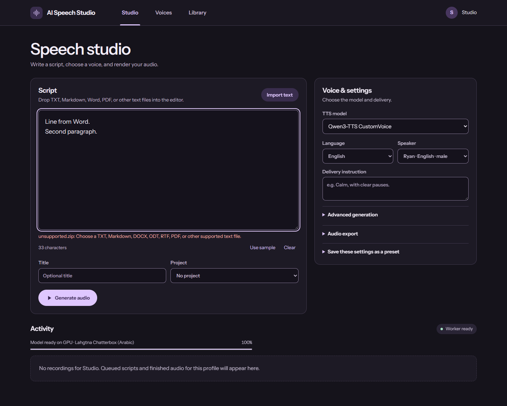
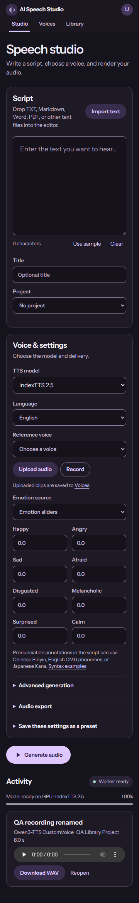

# AI Speech Studio

Self-hosted text-to-speech for scripts, documents, and audiobooks. Run inference on an NVIDIA GPU and manage voices, settings, and recordings from a desktop or mobile browser.

| Desktop Studio | Mobile voice controls |
| :---: | :---: |
|  |  |

[Desktop voice library screenshot](docs/screenshots/desktop-voices.png) · [Deployment and model runtimes](deploy/README.md) · [Reference audio and attribution](assets/references/README.md)

## Features

- **Seven model options** across Qwen3-TTS 12 Hz 1.7B CustomVoice and Base, Lahgtna Chatterbox, Chatterbox Multilingual V3, Higgs TTS 3 4B Q8 and BF16, and IndexTTS 2.5. Model-specific controls include voice cloning, reference transcripts, Arabic dialects, emotion, and pronunciation.
- **Document and ebook import** with drag and drop, a 65 MiB upload limit, and up to 5 million characters per import. Pick chapters, sections, or pages from EPUB and unprotected MOBI files.
- **Long narration** with runs of up to 600,000 characters and titles based on the selected ebook range. One worker processes one job and loads one TTS model at a time. Checkpoints allow unfinished runs to resume after service restarts.
- **Voice and recording libraries** with grouped references, editable transcripts, microphone recording, uploads, presets, profiles and projects. Export WAV, FLAC or MP3, or make a smaller MP3 for sharing.
- **Desktop and mobile support** with drafts that survive navigation, optional live hardware stats, Web Push notifications, and an installable mobile web app with an offline page.

## Start on Ubuntu

```bash
sudo apt update
sudo apt install git pipx ffmpeg poppler-utils libmobi-tools tesseract-ocr-eng tesseract-ocr-ara
pipx install uv
export PATH="$HOME/.local/bin:$PATH"

git clone https://github.com/ibrahim91015/AISpeechStudio.git ~/aispeech/tts-studio
cd ~/aispeech/tts-studio
./scripts/setup_ubuntu.sh web
.runtime/web/bin/python -m uvicorn app:app --host 127.0.0.1 --port 7860 --workers 1
```

Open http://127.0.0.1:7860 on the host. The setup script uses uv to install Python 3.11 and create a separate web environment. For a first synthesis test, confirm the NVIDIA driver with `nvidia-smi`, stop the web process, run `./scripts/setup_ubuntu.sh qwen`, and start it again. This installs the CUDA runtime and weights for Qwen CustomVoice.

For other models, follow the [runtime and weight instructions](deploy/README.md#model-runtimes). Start with one model if disk space is limited.

```bash
python3 scripts/download_models.py all --plan
uv run --no-project --python 3.11 --with huggingface_hub scripts/download_models.py qwen_base lahgtna dialect_router
uv run --no-project --python 3.11 --with huggingface_hub scripts/download_models.py all
```

The optional `all` command fetches every checkpoint and the IndexTTS auxiliary weights into the paths expected by the adapters.

### Start at boot

```bash
install -Dm644 deploy/aispeech-studio.service ~/.config/systemd/user/aispeech-studio.service
sudo loginctl enable-linger "$(id -un)"
systemctl --user daemon-reload
systemctl --user enable --now aispeech-studio.service
systemctl --user status aispeech-studio.service
```

The example unit binds to loopback. To access it remotely, point an authenticated HTTPS reverse proxy at port 7860. Profiles organize the library and do not enforce access control. See [Host the app](deploy/README.md#host-the-app) for the proxy and Web Push settings.

## How import and narration work

| Input | Extraction |
| --- | --- |
| EPUB and MOBI | Read the ebook spine in order. Use EPUB navigation or NCX for chapter and page boundaries, with headings and internal contents links as fallbacks. Convert unprotected MOBI locally with libmobi. Skip images, alt text, navigation and recognized front and back matter. Label pages as estimated when the book has no page markers. |
| PDF | Prefer native text and use tagged paragraphs when tags cover the content. Reflow print lines and remove recognizable repeated headers and page numbers. Apply bounded English/Arabic OCR when needed, and report scanned or skipped pages. |
| DOCX, ODT and RTF | Extract body text and preserve paragraph breaks. Word and ODT imports skip known non-body content such as hidden text and page markers. |
| Plain text, HTML and captions | Import TXT, Markdown, CSV, TSV, JSON, XML, YAML, log and RST as text. Remove hidden HTML markup and extract subtitle text from SRT and VTT. |

Imports run in a bounded background process while the browser polls for results. During narration, the worker splits each run into shorter passages, retries with smaller passages when supported models reach their audio token limit, and checkpoints each finished chunk. FFmpeg stitches and exports the recording with optional loudness normalization.

## Reference voices and data

The Ubuntu setup installs the bundled public references. Run `python3 scripts/install_references.py --upstream` to fetch additional model demos from their publishers, then restart the service to reload the catalog. [Reference sources and transcripts](assets/references/README.md)

The app stores profiles, uploads, jobs, audio, and Web Push keys in `data/` by default. Set `TTS_DATA_DIR` to choose another location. Back up that directory to preserve your library. [Regression tests](tests/README.md)
